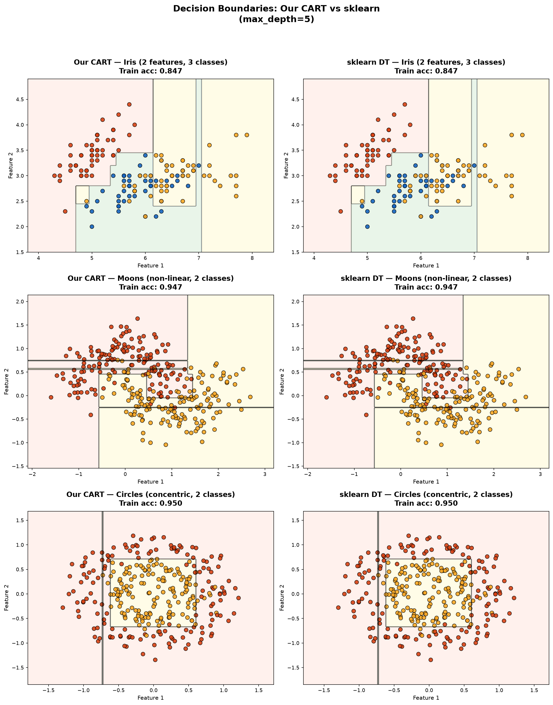
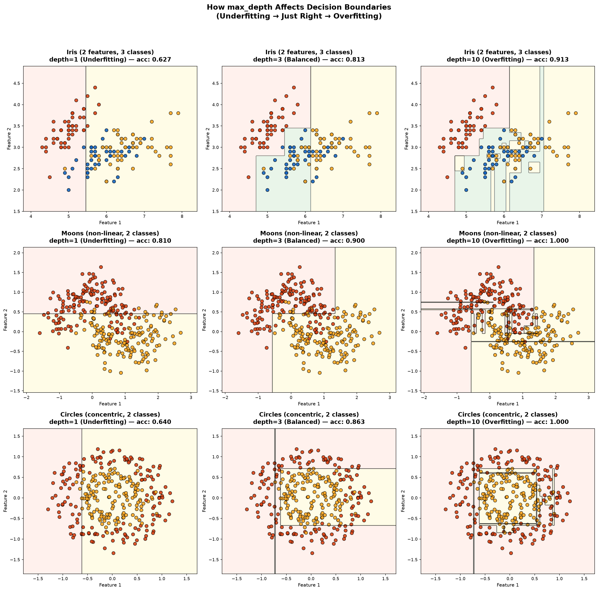
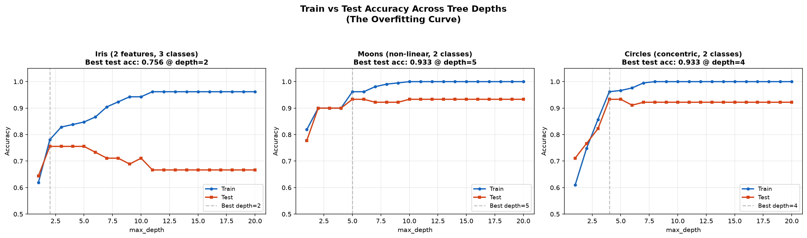
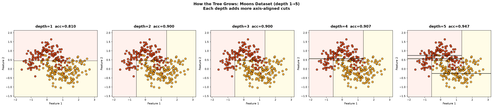

# 🌳 Decision Tree (CART) — From Scratch

<div align="center">


</div>

<br>

> A **complete CART (Classification and Regression Tree)** classifier implemented from scratch using only **NumPy** — no sklearn for the tree itself. Built for **deep understanding**, not just usage. Includes both a naive O(n²) and an optimized O(n log n) split search, plus a 4-figure visualization suite that exposes how trees learn, overfit, and compare with sklearn.

---

## 📂 Project Structure

```
Decission Tree/
├── cart_from_scratch.py         # 🧠 Full CART implementation (434 lines)
│                                #    ├── gini_impurity()
│                                #    ├── weighted_gini()
│                                #    ├── best_split_numeric()          ← naive O(n²)
│                                #    ├── best_split_numeric_optimized() ← O(n log n)
│                                #    ├── find_best_split()             ← outer feature loop
│                                #    ├── Node class
│                                #    └── DecisionTreeCART class        ← fit / predict / print_tree
│
├── decision_boundary_viz.py     # 📊 4-figure visualization suite (259 lines)
│                                #    ├── plot_decision_boundary()      ← mesh grid + contourf
│                                #    └── run_visualization()           ← generates all 4 figures
│
├── plots/                       # 🖼️ Generated visualization outputs
│   ├── fig1_ours_vs_sklearn.png #    Our tree vs sklearn (3 datasets)
│   ├── fig2_depth_effect.png    #    Depth 1 → 3 → 10 boundaries
│   ├── fig3_overfitting_curve.png # Train vs Test accuracy
│   └── fig4_tree_growth.png     #    Tree growth depth 1→5
│
├── main.py                      #    PyCharm scaffold (unused)
└── README.md                    # 📖 You are here
```

---

## 🧠 What is CART?

**CART** (Classification And Regression Trees) is a greedy, recursive partitioning algorithm invented by **Leo Breiman et al. (1984)**. It builds a binary tree by repeatedly splitting the feature space — at each internal node, it picks the **(feature, threshold)** pair that produces the purest child nodes.

```
                    ┌─────────────────────┐
                    │  Is petal_length     │
                    │     ≤ 2.45?          │
                    └────────┬────────────┘
                       yes / \ no
                          /   \
                   ┌─────┐     ┌──────────────────┐
                   │Setosa│     │ Is petal_width    │
                   │(leaf)│     │    ≤ 1.75?        │
                   └──────┘     └───────┬──────────┘
                                  yes / \ no
                                     /   \
                              ┌──────────┐  ┌──────────┐
                              │Versicolor│  │ Virginica│
                              │  (leaf)  │  │  (leaf)  │
                              └──────────┘  └──────────┘
```

CART is the foundation for **Random Forests** (many CART trees voting) and **Gradient Boosted Trees** (XGBoost, LightGBM, CatBoost).

---

## 🔬 Code Walkthrough — `cart_from_scratch.py`

This file implements a complete CART classifier in **6 numbered sections**. Each section below explains what the code does, why it works, and the key code snippet.

---

### Section 1 · Gini Impurity — Measuring Node Purity

> **File:** `cart_from_scratch.py` **Lines:** 25–42

Gini impurity measures "if I randomly pick two samples from this node and label one with the other's label, how often would I be wrong?"

```
Gini(node) = 1 − Σ (pᵢ)²     where pᵢ = fraction of class i
```

| Scenario | Gini | Meaning |
|----------|------|---------|
| All same class (e.g. [🔴🔴🔴🔴]) | **0.0** | Pure — no uncertainty |
| Binary 50-50 (e.g. [🔴🔴🔵🔵]) | **0.5** | Maximum impurity |
| 3-class equal (e.g. [🔴🔵🟢]) | **0.667** | High impurity |

**Code:**
```python
def gini_impurity(y):
    counts = np.bincount(y)            # [count_class_0, count_class_1, ...]
    probabilities = counts / len(y)    # convert to fractions
    return 1.0 - np.sum(probabilities ** 2)
```

**Example:** Node with 30 cats and 20 dogs:
```
p_cat = 30/50 = 0.6,  p_dog = 20/50 = 0.4
Gini  = 1 − (0.6² + 0.4²) = 1 − (0.36 + 0.16) = 0.48
```

---

### Section 2 · Weighted Gini — Scoring a Split

> **File:** `cart_from_scratch.py` **Lines:** 45–59

When we split a node into left & right children, the split quality is the **weighted average** of their Gini values:

```
Gini_split = (n_left/n) × Gini(left) + (n_right/n) × Gini(right)
```

We want to **minimize** this — lower weighted Gini = purer children = better split.

**Code:**
```python
def weighted_gini(y_left, y_right):
    n = len(y_left) + len(y_right)
    return (len(y_left) / n) * gini_impurity(y_left) + \
           (len(y_right) / n) * gini_impurity(y_right)
```

**Example:** Splitting 50 animals by "has_fur ≤ 0.5":
```
Left  (35 samples): 30 cats, 5 dogs  → Gini = 1 − (0.857² + 0.143²) = 0.245
Right (15 samples):  0 cats, 15 dogs → Gini = 0.0 (pure!)

Weighted Gini = (35/50)(0.245) + (15/50)(0.0) = 0.171  ← good split!
```

---

### Section 3 · Threshold Selection — Why Midpoints?

> **File:** `cart_from_scratch.py` **Lines:** 62–114

This is the **crucial insight**: for a numeric feature, you don't try arbitrary thresholds. You only try **midpoints between consecutive distinct sorted values**.

#### Why?

The split only changes which points go left/right when you cross from one data value to the next. Any threshold strictly between two consecutive data points produces the **identical** left/right partition — so trying multiple thresholds in that gap is redundant. A threshold placed exactly **on** a data point risks ambiguity — the midpoint avoids that.

#### Concrete Example

Say the "Age" column at some node has these unique sorted values:

```
[22, 25, 30, 38, 40]
```

Candidate thresholds are the **midpoints** between each consecutive pair:

```
(22+25)/2 = 23.5
(25+30)/2 = 27.5
(30+38)/2 = 34.0
(38+40)/2 = 39.0
```

→ 5 unique values, **4 candidate thresholds** (n−1 in general).

You test `Age ≤ 23.5`, `Age ≤ 27.5`, `Age ≤ 34.0`, `Age ≤ 39.0` — compute Gini gain for each — and keep the winner.

#### Naive Implementation (O(n²) per feature)

```python
def best_split_numeric(X_col, y, parent_impurity, n_samples):
    best_gain, best_threshold = -1, None
    sorted_vals = np.unique(X_col)    # distinct sorted values

    for i in range(len(sorted_vals) - 1):
        threshold = (sorted_vals[i] + sorted_vals[i+1]) / 2   # midpoint
        left_mask = X_col <= threshold
        right_mask = ~left_mask

        y_left, y_right = y[left_mask], y[right_mask]
        w_impurity = (len(y_left)/n_samples)*gini_impurity(y_left) + \
                     (len(y_right)/n_samples)*gini_impurity(y_right)
        gain = parent_impurity - w_impurity

        if gain > best_gain:
            best_gain, best_threshold = gain, threshold

    return best_threshold, best_gain
```

For each threshold: mask the data (O(n)) + compute Gini from scratch (O(n)) = **O(n) per threshold**, with ~n thresholds → **O(n²) per feature**. Simple and correct, but slow on large datasets.

---

### Section 3b · Optimized Split — O(n log n) Sliding Window

> **File:** `cart_from_scratch.py` **Lines:** 117–181

The naive version recomputes class counts from scratch for every threshold. The optimized version **sorts once and slides**:

```
1. Sort samples by feature value              → O(n log n)
2. Start with ALL samples on the right side
3. Slide threshold left-to-right:
   - Move one sample from right → left        → O(1) count update
   - If the value changed, evaluate threshold
   - Compute Gini from running counts          → O(k) not O(n)
4. Total: O(n log n) + O(n × k) ≈ O(n log n)   since k ≪ n
```

#### Visual Walkthrough

```
Sorted by Age:  [22, 25, 25, 30, 38, 40]
Labels:         [ 0,  1,  0,  1,  1,  0]

Step 0: LEFT = []           RIGHT = [22,25,25,30,38,40]
        counts: {0:0, 1:0}  counts: {0:3, 1:3}

Step 1: move 22 → LEFT      threshold = (22+25)/2 = 23.5
        LEFT = [22]          RIGHT = [25,25,30,38,40]
        counts: {0:1, 1:0}  counts: {0:2, 1:3}
        → compute Gini from counts in O(k), not O(n)!

Step 2: move 25 → LEFT      (next is also 25, SKIP — same value)
Step 3: move 25 → LEFT      threshold = (25+30)/2 = 27.5
        LEFT = [22,25,25]   RIGHT = [30,38,40]
        counts: {0:2, 1:1}  counts: {0:1, 1:2}
        → evaluate this threshold

... and so on
```

**Code (key inner loop):**
```python
for i in range(n_samples - 1):
    # Move sample i from right → left
    c = sorted_labels[i]
    left_counts[c] += 1       # O(1) update!
    right_counts[c] -= 1
    n_left += 1
    n_right -= 1

    # Skip duplicates — no new threshold possible
    if sorted_vals[i] == sorted_vals[i + 1]:
        continue

    # Midpoint threshold
    threshold = (sorted_vals[i] + sorted_vals[i + 1]) / 2.0

    # Gini from counts — O(k) instead of O(n)
    gini_left = 1.0 - np.sum((left_counts / n_left) ** 2)
    gini_right = 1.0 - np.sum((right_counts / n_right) ** 2)
```

---

### Section 4 · Find Best Split — Across All Features

> **File:** `cart_from_scratch.py` **Lines:** 184–223

The outer loop: for each feature, find its best threshold using the optimized sliding-window search, then pick the feature with the **highest information gain**.

```
find_best_split(X, y):
    For each feature f in [0, 1, ..., m-1]:
        threshold_f, gain_f = best_split_numeric_optimized(X[:, f], y, ...)
        if gain_f > best_gain_overall:
            winner = (f, threshold_f, gain_f)
    return winner
```

> **Extension point:** If you had categorical features, you'd also call `best_split_categorical()` here and compare its gain against the numeric features' gains — the overall winner becomes the node's split.

**Total complexity per node:** O(m × n log n) where m = features, n = samples.

---

### Section 5 · Node — The Tree's Building Block

> **File:** `cart_from_scratch.py` **Lines:** 226–251

Each node stores everything needed for both splitting and diagnostics:

```python
class Node:
    # Internal node attributes
    feature           # which feature index to split on
    threshold         # the split value
    left, right       # child Node references

    # Leaf / diagnostic attributes
    predicted_class   # majority class at this node
    gini              # impurity at this node
    n_samples         # how many training samples reached here
    class_counts      # e.g. {0: 30, 1: 20}

    @property
    def is_leaf(self):
        return self.left is None and self.right is None
```

---

### Section 6 · DecisionTreeCART — The Full Classifier

> **File:** `cart_from_scratch.py` **Lines:** 254–372

The main class with three public methods:

#### `fit(X, y)` — Build the tree recursively

```
_build_tree(X, y, depth):
    1. Create node with majority class + diagnostics
    2. Check STOPPING CONDITIONS:
       - depth ≥ max_depth?           → return leaf
       - node already pure (Gini=0)?  → return leaf
       - n_samples < min_samples_split? → return leaf
    3. Find best split across all features
    4. Check min_samples_leaf constraint
    5. RECURSE on left and right children
```

**Stopping conditions control overfitting:**

| Condition | Parameter | Default | What it prevents |
|-----------|-----------|---------|-----------------|
| Max depth reached | `max_depth` | `10` | Excessively deep trees |
| Already pure | Gini = 0 | — | Useless splits |
| Too few to split | `min_samples_split` | `2` | Splitting tiny groups |
| Child too small | `min_samples_leaf` | `1` | Leaves with 1 sample |

#### `predict(X)` — Walk each sample down the tree

```
_predict_sample(x, node):
    if node is a LEAF → return predicted_class
    if x[feature] ≤ threshold → go LEFT
    else → go RIGHT
```

Each prediction traverses root → leaf in **O(depth)** time.

#### `print_tree()` — Pretty-print the tree structure

Produces human-readable output showing every split decision:

```
ROOT  petal length (cm) <= 2.4500?  gini=0.664  n=105
  │ L → LEAF  class=0  gini=0.000  n=31  counts={0: 31}
  │ R  petal width (cm) <= 1.6500?  gini=0.500  n=74
  │   │ L  ...
  │   │ R  ...
```

---

### Demo — Iris Dataset + sklearn Comparison

> **File:** `cart_from_scratch.py` **Lines:** 375–434

The `__main__` block trains on the **Iris dataset** (4 features, 3 classes) and compares with sklearn:

```
python cart_from_scratch.py
```

```
══════════════════════════════════════════════════════════════════════
  CART Decision Tree — From Scratch vs sklearn
══════════════════════════════════════════════════════════════════════

📊 Our scratch-built tree structure:

ROOT  petal length (cm) <= 2.4500?  gini=0.664  n=105
  │ L → LEAF  class=0  gini=0.000  n=31  counts={0: 31}
  │ R  petal length (cm) <= 4.7500?  gini=0.500  n=74
  │   │ L  ...
  │   │ R  ...

──────────────────────────────────────────────────
  Our tree accuracy:     1.0000  (45/45)
  sklearn tree accuracy: 1.0000  (45/45)
──────────────────────────────────────────────────
  ✅ Both trees agree on every test sample!
```

---

## 🎨 Code Walkthrough — `decision_boundary_viz.py`

This script uses the CART tree we built and generates **4 publication-quality figures** to visualize how decision trees actually learn.

---

### How Decision Boundary Plotting Works

> **File:** `decision_boundary_viz.py` **Lines:** 34–88

The `plot_decision_boundary()` function is the core visualization helper:

```
1. Create a fine mesh grid (300×300) covering the 2D feature space
2. Predict the class for EVERY point on the grid (90,000 predictions)
3. Color each grid point by its predicted class → shows the "regions"
4. Draw contour lines where the class changes → the decision boundaries
5. Scatter the actual training data points on top
```

```python
# Step 1: Create mesh grid
xx, yy = np.meshgrid(np.linspace(x_min, x_max, 300),
                     np.linspace(y_min, y_max, 300))

# Step 2: Predict every grid point
Z = clf.predict(np.c_[xx.ravel(), yy.ravel()])
Z = Z.reshape(xx.shape)

# Step 3: Paint colored regions
ax.contourf(xx, yy, Z, alpha=0.4, cmap=pastel_colors)

# Step 4: Draw boundary lines
ax.contour(xx, yy, Z, colors='k', linewidths=0.5)

# Step 5: Scatter data points
ax.scatter(X[:, 0], X[:, 1], c=y, cmap=bold_colors, edgecolors='black')
```

This technique works for **any** classifier with a `.predict()` method — not just trees.

---

### Datasets Used

> **File:** `decision_boundary_viz.py` **Lines:** 98–111

Three 2D datasets with different geometries test how well axis-aligned splits handle various shapes:

| Dataset | Source | Classes | Geometry | Challenge for Trees |
|---------|--------|---------|----------|-------------------|
| **Iris** (first 2 features) | `load_iris()` | 3 | Roughly linear | Moderate — overlapping classes |
| **Moons** | `make_moons(noise=0.25)` | 2 | Curved crescents | Hard — needs many splits to approximate curves |
| **Circles** | `make_circles(noise=0.15)` | 2 | Concentric rings | Hardest — axis-aligned splits can't form circles |

---

## 📊 Visualizations — What Each Figure Shows

### Figure 1 · Our CART vs sklearn

> **File:** `decision_boundary_viz.py` **Lines:** 115–143

Trains both our scratch-built tree and sklearn's `DecisionTreeClassifier` (both with `max_depth=5, criterion='gini'`) on all 3 datasets, side by side.

**What to look for:** The boundaries are **nearly identical** — proving our implementation is correct. Both use the same algorithm: greedy Gini-minimizing splits.



---

### Figure 2 · Effect of `max_depth` on Boundaries

> **File:** `decision_boundary_viz.py` **Lines:** 145–171

Shows each dataset at **depth=1** (underfitting), **depth=3** (balanced), and **depth=10** (overfitting).

**What to look for:**
- **Depth 1** — only ONE split. The boundary is a single straight line. High bias, low variance.
- **Depth 3** — a few splits carve reasonable regions. Good balance.
- **Depth 10** — the tree memorizes individual training points, creating tiny "islands" of color. Low bias, high variance. These wiggly boundaries **won't generalize**.



> 🔑 **Key insight:** All boundaries are **axis-aligned** (vertical/horizontal lines) — this is a fundamental limitation of splitting on one feature at a time. Trees can never make diagonal boundaries in a single split.

---

### Figure 3 · The Overfitting Curve (Bias-Variance Tradeoff)

> **File:** `decision_boundary_viz.py` **Lines:** 173–222

Plots **train accuracy** (blue) and **test accuracy** (red) for depths 1 through 20.

**What to look for:**
- **Train accuracy** always goes up (the tree memorizes more training data)
- **Test accuracy** peaks around depth 3–5, then **drops** — this IS overfitting
- The gap between train and test curves is the **variance** component

```
Train acc ──────────────────────── 100%
              ╱ ‾‾‾‾‾‾‾‾‾‾‾‾‾‾‾
             ╱
            ╱    ← gap = overfitting
Test acc   ╱╲
          ╱  ╲──────────────────── drops!
         ╱
        ╱
────────┬───┬───────────────────── depth
        1   5  10  15  20
            ↑
        best depth
```



---

### Figure 4 · Watching the Tree Grow (Step by Step)

> **File:** `decision_boundary_viz.py` **Lines:** 224–246

Shows the **Moons** dataset at depths 1, 2, 3, 4, 5 — revealing how the tree progressively carves up the space with each additional level.

**What to look for:**
- **Depth 1** → one horizontal/vertical cut
- **Depth 2** → that cut + one more in each child
- **Depth 3+** → the staircase pattern approximating the curved moon boundary



> 🔑 **Key insight:** Trees approximate curves by stacking many axis-aligned cuts — like drawing a circle using only horizontal and vertical lines on graph paper.

---

## 🚀 Getting Started

### Prerequisites

```bash
pip install numpy matplotlib scikit-learn
```

> **Note:** scikit-learn is used **only** for datasets and comparison — the CART tree itself is pure NumPy.

### Running

```bash
# Train on Iris, print tree, compare with sklearn
python cart_from_scratch.py

# Generate all 4 visualization figures (saved to plots/)
python decision_boundary_viz.py
```

---

## ⚙️ Hyperparameters

```python
from cart_from_scratch import DecisionTreeCART

tree = DecisionTreeCART(
    max_depth=5,            # how deep the tree can grow
    min_samples_split=4,    # min samples needed to attempt a split
    min_samples_leaf=2,     # min samples required in each child
)
tree.fit(X_train, y_train, feature_names=["Age", "Fare"])
predictions = tree.predict(X_test)
tree.print_tree()           # visualize the learned structure
```

| Parameter | Default | ↑ Higher | ↓ Lower |
|-----------|---------|----------|---------|
| `max_depth` | `10` | Simpler tree, more bias | Complex tree, more variance |
| `min_samples_split` | `2` | Prevents splitting small groups | Allows splitting 2-sample nodes |
| `min_samples_leaf` | `1` | Bigger leaves, smoother boundaries | Can create single-sample leaves |

---

## 📐 Complexity Analysis

| Operation | Naive | Optimized (our code) |
|-----------|-------|---------------------|
| **Per-feature split search** | O(n²) — recompute Gini each time | **O(n log n)** — sort + slide |
| **Per-node (m features)** | O(m × n²) | **O(m × n log n)** |
| **Full tree (d levels)** | O(d × m × n²) worst case | **O(d × m × n log n)** |
| **Prediction (1 sample)** | — | O(depth) |
| **Prediction (n samples)** | — | O(n × depth) |

Where: n = samples, m = features, d = depth (≤ `max_depth`), k = classes.

---

## 🔑 Key Takeaways

| # | Insight | Why it matters |
|---|---------|---------------|
| 1 | **Boundaries are axis-aligned** | Trees split on one feature at a time → only horizontal/vertical cuts. Can't make diagonal or curved boundaries in a single split. |
| 2 | **Deeper ≠ better** | Test accuracy peaks around depth 3–5, then drops. Train accuracy always rises. This IS the bias-variance tradeoff. |
| 3 | **Midpoints are sufficient** | Any threshold between two consecutive values gives the same split. Midpoints avoid on-data-point ambiguity. n values → n−1 thresholds. |
| 4 | **O(n²) → O(n log n)** | Sorting once + sliding incremental counts avoids redundant O(n) recomputation per threshold. Same result, much faster. |
| 5 | **Our tree ≈ sklearn** | Both use identical greedy Gini logic. Minor differences only from tie-breaking when multiple splits have the same Gini. |
| 6 | **Greedy ≠ globally optimal** | CART makes locally optimal splits. A suboptimal early split can't be fixed later. This is why ensembles (Random Forest, XGBoost) exist. |

---

## 🛠️ Tech Stack

<div align="center">


</div>

---

## 📖 References

- Breiman, L. et al. (1984). *Classification and Regression Trees*. Wadsworth.
- scikit-learn documentation — [Decision Trees](https://scikit-learn.org/stable/modules/tree.html)
- DataCamp ML tracks — Supervised Learning with scikit-learn

---

<div align="center">
  Made with ❤️ by <b>Piyush Maji</b>
</div>
